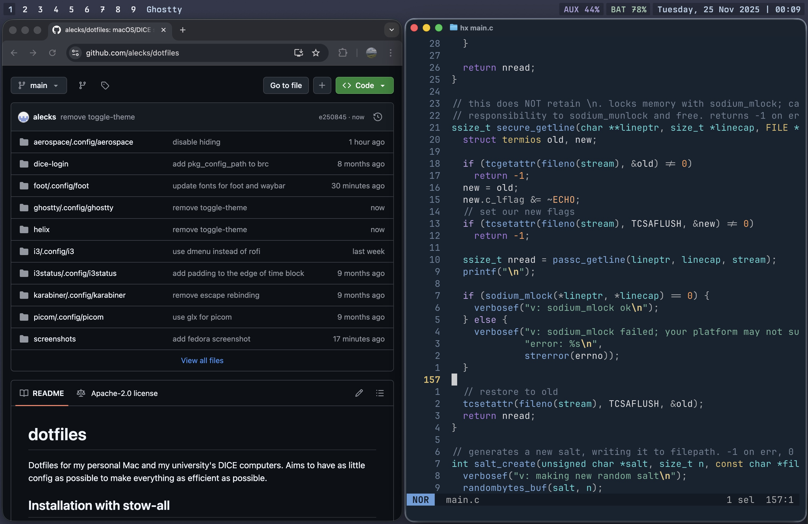
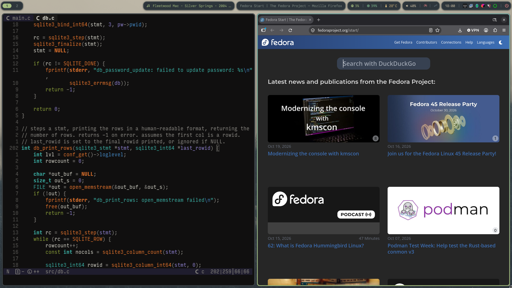
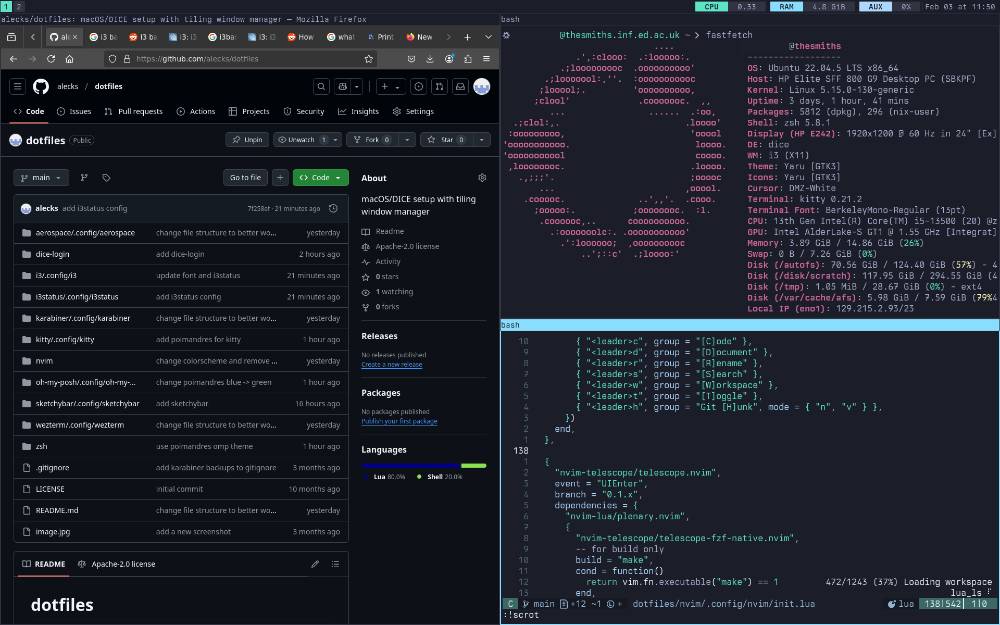

# dotfiles

Dotfiles for my Mac, PC and my university's Linux systems. I try to make everything work nicely without needing tons of config.

## Installation with stow-all

Stow is a GNU tool that can be used to symlink your config from one main folder to the actual locations expected by programs.

This repository has a `stow-all.sh` script which can be used to install configurations from a `stowlist`. For example, `./stow-all.sh stowlist-dice` will install all configurations relevant for DICE.

## Shared

- [Helix](https://helix-editor.com) code editor
- ...or [Neovim](https://neovim.io) code editor (because I can never decide which I want)
- [Ghostty](https://ghostty.org) terminal
- [Fish](https://fishshell.com/) shell
- [Berkeley Mono](https://berkeleygraphics.com/typefaces/berkeley-mono) typeface (not included here)
- [Input Mono](https://input.djr.com) font too, when I feel like it
- [Flexoki](https://stephango.com/flexoki) colourscheme for code
- [Everforest](https://github.com/sainnhe/everforest) colourscheme for UI

See `stowlist-shared`.

## Mac (macOS Golden Gate)

- [Aerospace](https://github.com/nikitabobko/AeroSpace) tiling window manager
- [Karabiner Elements](http://karabiner-elements.pqrs.org/) for hyperkey with CapsLock

(very outdated)

See `stowlist-mac`.

## PC (Fedora 44)

 [Fedora Workstation](https://fedoraproject.org/workstation/).

- [Hyprland](https://hypr.land) tiling window manager
- [Waybar](https://github.com/Alexays/Waybar) status bar
- [Tofi](https://github.com/philj56/tofi) application launcher
- [Mako](https://github.com/emersion/mako) notification daemon

## DICE (University)

DICE is the computer system built for the School of Informatics at the University of Edinburgh. It can be configured extensibly despite being an operating system for students on shared computers.

- [i3](https://i3wm.org) window manager, with i3status and [picom](https://picom.app)
- [infpi](https://github.com/alecks/infpi) for local package management, with the ability to use Nix (see dice-login)

See `stowlist-dice`. The DICE dotfiles should work on an unmodified DICE install, with no extra programs downloaded. Picom is optional for less screen tearing, but is a pain to install.
